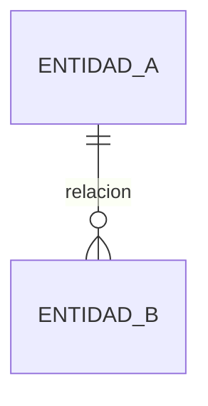

# DATA-Analisis-Fuentes. <Nombre del caso de uso>

> **Estado:** borrador · **Versión:** 0.1 · **Fecha:** AAAA-MM-DD · **Fuentes:** `RFP/...`, `data-samples/...`, `proposal/_meta/data-profiles/`

## 1. Contexto Y Alcance Del Análisis

<Qué decisiones o funcionalidades dependen de los datos; qué muestras se han analizado y su representatividad.>

## 2. Inventario De Fuentes

| ID | Fuente | Sistema / propietario | Dominio | Tipo | Acceso | Formato | Frecuencia / frescura | Volumen | Muestra | Estado / evidencia |
| --- | --- | --- | --- | --- | --- | --- | --- | --- | --- | --- |
| SRC-01 | | | | | | | | | Sí / No | |

## 3. Dominios De Datos Y Entidades

| Dominio | Entidades | Campos clave | Fuentes | Uso en el caso de uso |
| --- | --- | --- | --- | --- |

## 4. Perfilado De Muestras

| Dataset | Filas / columnas | Claves candidatas | Cobertura temporal | Hallazgos principales | Perfil |
| --- | --- | --- | --- | --- | --- |

## 5. Calidad De Datos

| ID | Dimensión | Fuente / campo | Hallazgo | Impacto | Tratamiento propuesto |
| --- | --- | --- | --- | --- | --- |
| DQ-01 | Completitud / Unicidad / Validez / Consistencia / Actualidad / Exactitud | | | | |

## 6. Datos Personales Y Clasificación

| Fuente / campo | Categoría | Necesario para | Tratamiento | Estado / evidencia |
| --- | --- | --- | --- | --- |

## 7. Modelo Conceptual

## 8. Linaje Y Flujos De Datos

## 9. Contratos De Datos

### SRC-01 · <fuente>

| Aspecto | Definición | Estado / evidencia |
| --- | --- | --- |
| Esquema y tipos | | |
| Claves y unicidad | | |
| Frecuencia / frescura | | |
| Volumetría | | |
| SLA y ventanas | | |
| Errores y reintentos | | |
| Versionado y cambios | | |
| Propietario | | |

## 10. Estrategia De Integración

| Opción | Ventajas | Riesgos | Recomendación / condición |
| --- | --- | --- | --- |

## 11. Arquitectura De Datos Propuesta

## 12. Idoneidad Para Analítica E IA

| Aspecto | Situación | Implicación | Estado / evidencia |
| --- | --- | --- | --- |
| Profundidad histórica | | | |
| Disponibilidad de etiqueta / target | | | |
| Granularidad | | | |
| Riesgo de fuga de información | | | |
| Latencia requerida vs disponible | | | |

## 13. Gaps, Dependencias Y Preguntas

| Gap | Bloquea | Pregunta | Supuesto de trabajo |
| --- | --- | --- | --- |

## 14. Riesgos De Datos

| Riesgo | Impacto | Mitigación |
| --- | --- | --- |

## 15. Referencias
