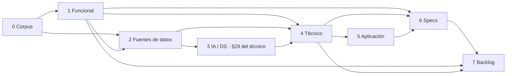

# Pipeline de diseño

## Dependencias mínimas por fase

| Fase | Requiere | Opcional |
| --- | --- | --- |
| 1 Funcional | Corpus o descripción del usuario | Matriz, preguntas |
| 2 Datos | Corpus o funcional | Muestras |
| 3 IA/DS (sección 29 del documento técnico) | Funcional | Datos |
| 4 Técnico | Funcional | Datos, IA |
| 5 Aplicación | Técnico | Restricciones de stack |
| 6 Specs | Funcional + técnico | Aplicación, datos, IA |
| 7 Backlog | Funcional + técnico | Specs, datos, IA, aplicación |

## Estado del pipeline

`proposal/_meta/se-pipeline-state.md` contiene una tabla `Fase | Aplica | Estado | Artefacto | Última actualización | Notas` con estados `pendiente`, `en curso`, `borrador`, `en revisión`, `validado`, `bloqueado`, `no aplica`.

## Propagación de cambios

Cuando cambia un artefacto validado aguas arriba:
1. Ejecuta `check_traceability.py`.
2. Marca como `en revisión` los artefactos aguas abajo afectados.
3. Lista en el estado qué IDs cambiaron y qué documentos los consumen.
