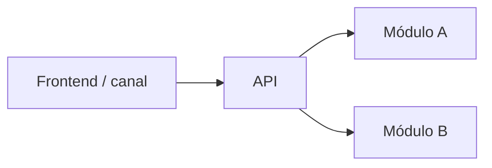

# APP-Diseno. <Nombre del caso de uso>

> **Estado:** borrador · **Versión:** 0.1 · **Fecha:** AAAA-MM-DD · **Fuentes:** `proposal/HU-Enfoque-Tecnico-&-Arquitectura-...`

## 1. Contexto Y Alcance

## 2. Decisiones De Stack (ADR)

### ADR-01. <Decisión>

| Campo | Contenido |
| --- | --- |
| Contexto | |
| Opciones | |
| Decisión / recomendación | |
| Consecuencias | |
| Estado | Propuesto / Aceptado / A confirmar |

## 3. Descomposición En Módulos

| Módulo / servicio | Responsabilidad | Stack | Datos que posee | HUs |
| --- | --- | --- | --- | --- |

## 4. Contratos API

| Operación | Método y ruta | Autorización | Idempotencia | Errores | Estado / evidencia |
| --- | --- | --- | --- | --- | --- |

## 5. Persistencia Y Modelo De Datos De Aplicación

## 6. Frontend Y Canal

| Pantalla / interacción | HU | Estados | Acciones |
| --- | --- | --- | --- |

## 7. Aspectos Transversales

| Aspecto | Diseño | Estado / evidencia |
| --- | --- | --- |
| Identidad y autorización | | |
| Errores | | |
| Logging y trazas | | |
| Configuración y secretos | | |
| Feature flags | | |

## 8. Componentes De IA Y Datos En La Aplicación

## 9. Estrategia De Pruebas

| Nivel | Alcance | Herramientas | Gate en CI |
| --- | --- | --- | --- |

## 10. Arquetipo De Repositorios Y Pipeline

## 11. Trazabilidad HU → Módulo → Operación

| HU | Módulo | Operaciones | Pantallas |
| --- | --- | --- | --- |

## 12. Dependencias, Riesgos Y Preguntas

## 13. Referencias
