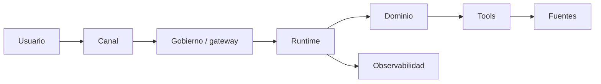
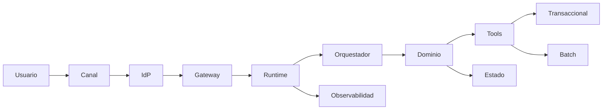

HU-Enfoque-Técnico-&-Arquitectura. <Nombre de la HU o caso de uso>

> **Estado:** borrador · **Versión:** 0.1 · **Fecha:** AAAA-MM-DD · **Fuentes:** `proposal/HU-Enfoque-Funcional-...`

## 1. Contexto

## 2. Objetivo Tecnico

<Implementación técnica objetivo en 1–2 párrafos.>

| Resultado funcional | Cobertura técnica requerida | Evidencia / estado |
| --- | --- | --- |

## 3. Resumen tecnico

## 4. Arquitectura objetivo basada en la evidencia

## 5. Flujo tecnico de referencia

## 6. Componentes y estado de madurez

| Componente | Responsabilidad técnica | Estado | Dependencia / decisión pendiente |
| --- | --- | --- | --- |

## 7. Alcance tecnico

## 8. Dominios de datos identificados

| Dominio de datos | Fuentes principales | Uso en la HU | Tipo de dato | Observaciones |
| --- | --- | --- | --- | --- |

## 9. Contratos pendientes / decisiones a confirmar

| Decisión / contrato pendiente | Impacto | Responsable sugerido | Urgencia |
| --- | --- | --- | --- |

## 10. No funcionales

| Categoría | Requisito / expectativa | Evidencia en el documento |
| --- | --- | --- |

## 11. Opciones tecnicas comparadas

Una subsección por cada decisión técnica abierta y relevante de este proyecto (las de §9, las pendientes de `proposal/_meta/decisiones.md` y las que se aparten de `se.preferencias.json`). Sin catálogo fijo: entre 2 y 8, ordenadas por impacto. Las de IA van en §29.6.

### 11.1 <Decisión>: <opción A> vs <opción B>

| Opción | Ventajas | Riesgos | Recomendación / condición | Decisión |
| --- | --- | --- | --- | --- |
| <opción A> | | | | `D-NNN` |
| <opción B> | | | | |

## 12. Diagrama de arquitectura objetivo preferida

## 13. Principios De Arquitectura

| Principio | Aplicación en la HU | Estado / evidencia |
| --- | --- | --- |

## 14. Componentes

| Componente | Rol técnico | Estado / evidencia |
| --- | --- | --- |

## 15. Arquitectura Objetivo

## 16. Flujos Tecnicos Detallados

### 16.1 <Inicio, sesión o invocación desde canal>

| Paso | Componente | Acción técnica | Red, seguridad y autenticación | Recurso implicado |
| ---: | --- | --- | --- | --- |
| 1 | | | | |

## 17. Trazabilidad Funcional A Flujos Tecnicos

| Flujo o regla funcional | Flujo técnico que lo implementa |
| --- | --- |

## 18. Integraciones

| Integración | Patrón | Uso | Consideración clave | Estado / evidencia |
| --- | --- | --- | --- | --- |

## 19. Seguridad E Identidad

| Control | Requisito técnico | Estado / evidencia |
| --- | --- | --- |

## 20. Infraestructura, Red Y Conectividad

| Elemento | Requisito | Estado / evidencia |
| --- | --- | --- |

## 21. Recursos Minimos Por Entorno

### 21.1 Perfil De Entornos

| Entorno | Perfil de infraestructura | Validaciones obligatorias antes de promover |
| --- | --- | --- |

### 21.2 Recursos Base

| Recurso | Uso | Red | Identidad y permisos | Estado / evidencia |
| --- | --- | --- | --- | --- |

## 22. Datos Y Contratos

| Contrato | Capacidades mínimas | Estado / evidencia |
| --- | --- | --- |

### 22.1 Contratos mínimos del dominio principal

### 22.2 Campos mínimos de respuesta

| Campo | Descripción | Obligatorio / opcional |
| --- | --- | --- |

### 22.3 Errores Funcionales Normalizados

| Código | Uso |
| --- | --- |

### 22.4 Matriz Tecnica De Fuentes Y Disponibilidad

| Familia | Fuente / sistema | Datos necesarios | Modo técnico | Muestras necesarias | Integración necesaria | Estado / evidencia |
| --- | --- | --- | --- | --- | --- | --- |

### 22.5 Persistencia De Datos

Qué datos guarda la solución (no los sistemas fuente de §22.4), dónde y con qué garantías. Una fila por almacén.

| Almacén | Datos que guarda | Tipo | Tecnología (decisión) | Propietario | Volumen y crecimiento | Consistencia | Retención y borrado | Backup / RPO / RTO | Cifrado y residencia | Estado / evidencia |
| --- | --- | --- | --- | --- | --- | --- | --- | --- | --- | --- |

Tipos: relacional, documental, clave-valor / caché, vectorial, ficheros / objetos, eventos / colas, analítico / lakehouse, estado conversacional o de sesión, registros de auditoría.

| Política | Definición | Estado / evidencia |
| --- | --- | --- |
| Datos personales y minimización | | |
| Copias derivadas y caché (frescura, invalidación) | | |
| Migraciones y versionado de esquema | | |
| Aislamiento entre clientes o unidades (si aplica) | | |
| Auditoría y trazabilidad de cambios | | |

## 23. Modelo De Desarrollo, Interfaces Y Evaluacion

### 23.1 Modalidad De Implementacion

| Artefacto | Modalidad prevista | Criterio técnico | Estado / evidencia |
| --- | --- | --- | --- |

### 23.2 Interfaces De Agente

Solo si la solución incluye agentes de IA; si no, `No aplica: <motivo>`. El diseño del agente está en §29.5; aquí, sus interfaces con el resto del sistema.

| Interfaz | Uso | Gobierno requerido | Estado / evidencia |
| --- | --- | --- | --- |

### 23.3 Arquetipo De Repositorios Y Artefactos

| Repositorio o carpeta | Contenido mínimo | Regla | Estado / evidencia |
| --- | --- | --- | --- |

### 23.4 Prompting, Evaluacion Y Calidad

Con componente de IA: resumen de los controles de calidad que afectan a la arquitectura (versionado de prompts, CI de evaluación, gates de promoción) remitiendo a §29.7 y §29.9 sin duplicarlos. Sin IA: `No aplica: <motivo>` (la calidad del software va en §25 y §26).

| Control | Requisito | Referencia | Estado / evidencia |
| --- | --- | --- | --- |

## 24. Observabilidad Y Operacion

| Señal | Uso operativo | Estado / evidencia |
| --- | --- | --- |

## 25. DevOps Y Gobierno

## 26. Criterios De Aceptacion Tecnicos

| ID | Criterio de aceptación |
| --- | --- |
| CAT-01 | Dado <contexto>, cuando <acción>, entonces <resultado>. |

## 27. Dependencias Tecnicas

## 28. Riesgos Tecnicos

| Riesgo | Impacto | Mitigación |
| --- | --- | --- |

## 29. Enfoque De IA Y Ciencia De Datos

> Redacta esta sección `se-arquitecto-ia-datos` con la skill `se-enfoque-ia-datos`. Si el caso de uso no tiene componente analítico ni de IA, sustituye las subsecciones por una línea: `No aplica: <motivo>`.

### 29.1 Contexto Y Problema

### 29.2 Clasificación Del Problema Y Alternativa Sin IA

| Aspecto | Valor | Estado / evidencia |
| --- | --- | --- |
| Tipo de problema | Reglas / Clasificación / Regresión / Forecasting / Optimización / NLP / RAG / Agente | |
| Alternativa sin IA (baseline) | | |
| Justificación de la IA | | |

### 29.3 Formulación

| Elemento | Definición | Estado / evidencia |
| --- | --- | --- |
| Decisión de negocio soportada | | |
| Unidad de predicción / generación | | |
| Target u objetivo | | |
| Horizonte | | |
| Frecuencia de inferencia | Batch / casi tiempo real / interactivo | |
| Consumidor | | |
| Coste del error | | |

### 29.4 Datos Y Features

| Feature / fuente de contexto | Origen (`SRC-NN`) | Disponible en momento de decisión | Riesgo | Estado / evidencia |
| --- | --- | --- | --- | --- |

### 29.5 Enfoque De Modelado O Diseño GenAI

### 29.6 Opciones Comparadas

| Opción | Ventajas | Riesgos | Recomendación / condición | Decisión |
| --- | --- | --- | --- | --- |

### 29.7 Evaluación

| Métrica | Tipo (técnica / negocio / seguridad / operación) | Umbral | Dataset | Estado / evidencia |
| --- | --- | --- | --- | --- |

### 29.8 Fases Y Criterios Go/No-Go

| Fase | Objetivo | Entregables | Criterio go/no-go |
| --- | --- | --- | --- |
| PoC | | | |
| Piloto | | | |
| Producción | | | |

### 29.9 MLOps / LLMOps

| Capacidad | Requisito | Estado / evidencia |
| --- | --- | --- |
| Versionado de datos, modelos y prompts | | |
| Registro de experimentos | | |
| CI de evaluación | | |
| Despliegue y rollback | | |
| Monitorización y deriva | | |
| Coste y consumo | | |

### 29.10 IA Responsable Y Cumplimiento

| Aspecto | Tratamiento | Estado / evidencia |
| --- | --- | --- |
| Supervisión humana | | |
| Explicabilidad / transparencia | | |
| Sesgo y equidad | | |
| Privacidad | | |
| Clasificación regulatoria | | A confirmar |

### 29.11 Coste, Latencia Y Escalado

### 29.12 Dependencias Y Riesgos De IA

| Tipo | Descripción | Impacto | Acción |
| --- | --- | --- | --- |
