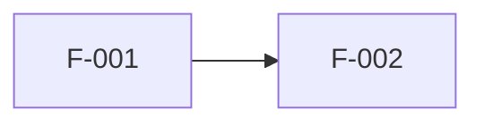

# Índice de features · <Caso de uso>

> **Estado:** borrador · **Versión:** 0.1 · **Fecha:** AAAA-MM-DD · **Fuentes:** `proposal/HU-Enfoque-Funcional-...`, `proposal/HU-Enfoque-Tecnico-&-Arquitectura-...`

| ID | Feature | Tipo | HUs | Depende de | Orden | Estado |
| --- | --- | --- | --- | --- | ---: | --- |
| F-001 | <nombre> | Usuario / Habilitadora / Datos / IA | HU-<ACR>-01 | — | 1 | borrador / lista / bloqueada |

