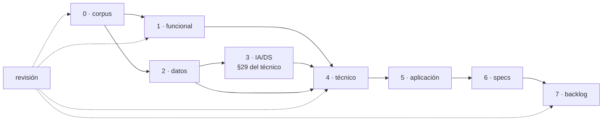
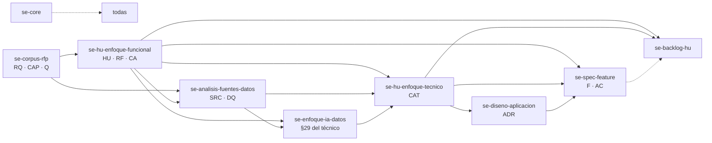

# Kit SE · Solutions Engineering (datos, IA y desarrollo Python/.NET)

Agentes, subagentes, skills, comandos y scripts para **OpenCode** (herramienta principal), **Claude Code** y **Codex** que cubren el diseño completo de una propuesta de preventa en proyectos mixtos de ciencia de datos, IA y desarrollo front/back en Python o .NET:

```text
corpus del cliente → requisitos → HUs aprobadas → fuentes de datos
→ arquitectura técnica (con el enfoque de IA/DS como sección 29) → diseño de aplicación → specs de features → backlog estimado
```

Los agentes redactan y razonan; los scripts deterministas validan, cuentan y trazan. Nada se da por bueno "a ojo": cada fase tiene un validador y los puntos de decisión humana (gates) no los puede saltar el agente.

**Pensado para convivir con otros kits.** Todo lleva el prefijo `se-` (Solutions Engineering): agentes `se-*`, comandos `/se-*`, skills `se-*`, configuración `se.config.json` y reglas en `.agents/se/`. El kit no ocupa `AGENTS.md` ni `CLAUDE.md`: solo añade un bloque delimitado que apunta a sus reglas, no se declara agente por defecto y sus skills solo se activan dentro del kit. Se instala y desinstala sin tocar lo de otros kits.

**Un repositorio, una propuesta.** El workspace es la raíz del repositorio: no hay carpetas por cliente ni por proyecto, y los comandos y scripts no necesitan ruta.

## Índice

1. [Instalación y convivencia con otros kits](#1-instalación-y-convivencia-con-otros-kits)
2. [Primeros pasos en 10 minutos](#2-primeros-pasos-en-10-minutos)
3. [Uso en cada herramienta](#3-uso-en-cada-herramienta)
4. [Recorrido completo por fases](#4-recorrido-completo-por-fases)
5. [Requisitos: barrido, consolidación y cobertura](#5-requisitos-barrido-consolidación-y-cobertura)
6. [Decisiones y preferencias tecnológicas](#6-decisiones-y-preferencias-tecnológicas)
7. [Referencia de agentes](#7-referencia-de-agentes)
8. [Referencia de comandos](#8-referencia-de-comandos)
9. [Referencia de skills](#9-referencia-de-skills)
10. [Referencia de herramientas (scripts)](#10-referencia-de-herramientas-scripts)
11. [Configuración (`se.config.json`)](#11-configuración-seconfigjson)
12. [Personalización](#12-personalización)
13. [Mantenimiento del kit](#13-mantenimiento-del-kit)
14. [Resolución de problemas](#14-resolución-de-problemas)

---

## 1. Instalación y convivencia con otros kits

### Requisitos

| Tipo | Qué | Para qué |
| --- | --- | --- |
| Obligatorio | [`uv`](https://docs.astral.sh/uv/getting-started/installation/) | Todo lo Python del kit se ejecuta con `uv run`; nunca con `python` directamente |
| Obligatorio | `make` | Instalación del kit (sin `make`: `uv run scripts/install.py …`) |
| Recomendado | `poppler-utils` (`pdftotext`, `pdftoppm`) | Texto por página y renderizado de páginas a imagen |
| Recomendado | LibreOffice | Convertir DOCX/PPTX/ODT a PDF para leerlos por página |
| Automático (`/se-init`) | `pandas`, `pyarrow`, `openpyxl`, `pdfplumber`, `pypdf`, `python-docx`, `python-pptx` | Perfilado de datos, tablas de PDF, lectura de Office |
| Opcional (`/se-init embeddings`) | `openai`, `azure-identity` | Similitud por embeddings con Azure OpenAI |

```bash
curl -LsSf https://astral.sh/uv/install.sh | sh             # uv en Linux/macOS (Windows: winget install astral-sh.uv)
sudo apt install poppler-utils libreoffice-core            # Debian/Ubuntu
brew install poppler && brew install --cask libreoffice     # macOS
winget install TheDocumentFoundation.LibreOffice            # Windows (poppler: conda install -c conda-forge poppler)
```

### Python con uv

El kit no instala nada en tu Python global ni llama a `python`: los agentes ejecutan los scripts con `uv run --group se …` y en OpenCode solo tienen permiso automático para `uv run *` (el resto de comandos pide confirmación, y `hu_gate.py approve` siempre pregunta).

`/se-init` prepara el entorno en la raíz del repositorio:

1. Si no hay `pyproject.toml` → `uv init --bare --no-workspace` (solo crea `pyproject.toml`, sin `main.py` ni README).
2. Si no hay `.venv` → `uv venv`.
3. Añade las dependencias del kit al **grupo `se`** de `pyproject.toml` (`uv add --group se …`). Van en un grupo propio para no mezclarse con las dependencias del proyecto ni con las de otros kits; por eso los scripts se lanzan con `--group se`.

Si el repositorio ya tiene `pyproject.toml` y `.venv`, no se tocan: solo se añade el grupo `se` si falta. `uv run` usa siempre el entorno del proyecto (`.venv`), aunque tengas otro activado. Las dependencias del grupo se pueden cambiar en `se.config.json` → `python`.

### Instalar en un repositorio

Desde la carpeta del kit, indicando el repositorio donde vas a trabajar la propuesta:

```bash
make opencode DEST=~/repos/propuesta-x     # OpenCode
make claude   DEST=~/repos/propuesta-x     # Claude Code
make codex    DEST=~/repos/propuesta-x     # Codex
make all      DEST=~/repos/propuesta-x     # las tres
make uninstall DEST=~/repos/propuesta-x    # quita el kit SE (conserva configuración y workspace)
make test                                  # smoke test: convivencia, MCP, instalación global…
```

Sin `make` (p. ej. Windows): `uv run scripts/install.py --tool claude <destino>` y `uv run scripts/install.py --uninstall <destino>`. Sin `DEST`, `make opencode|claude|codex|all` solo regenera las variantes dentro del propio kit.

Los tres harness reciben lo mismo: **agentes y comandos** (el método), **skills** (qué hacer en cada fase y cómo usar las herramientas) y el **servidor MCP `se-tools`** (las herramientas deterministas).

| Objetivo | Instala en el repositorio (solo elementos `se-*`) |
| --- | --- |
| `opencode` | `.opencode/agents/se-*.md`, `.opencode/commands/se-*.md`, `.agents/skills/se-*/`, `.agents/se/` (reglas y servidor), MCP en `.opencode/opencode.json`, bloque en `AGENTS.md` |
| `claude` | `.claude/agents/se-*.md`, `.claude/commands/se-*.md`, `.claude/skills/se-*/`, `.claude/se/`, `.claude/se-lider-proyecto.md`, MCP en `.mcp.json`, bloque en `CLAUDE.md` |
| `codex` | `.codex/agents/se-*.toml`, `.codex/se-lider-proyecto.md`, `.agents/skills/se-*/`, `.agents/se/`, MCP en un bloque de `.codex/config.toml`, bloque en `AGENTS.md` |

Las tres instalan también `se.config.json` (fusionando claves nuevas) y `se.preferencias.json` (solo si no existe). Los ficheros de configuración MCP se fusionan con lo que ya tengas y desinstalar quita solo la entrada `se-tools`. Con `PLUGIN=1` (o `--opencode-plugin`) se instala además el plugin nativo `.opencode/plugins/se-tools.js`, una alternativa al MCP en OpenCode 2 que normalmente no hace falta.

### Instalar de forma global (para todos tus repositorios)

```bash
make global                  # OpenCode, Claude Code y Codex en tu carpeta personal
make global TOOL=claude      # solo uno
make global-uninstall        # quitarlo
# sin make: uv run scripts/install.py --tool all --global   ·   --uninstall --global
```

| Harness | Dónde queda |
| --- | --- |
| OpenCode | `~/.config/opencode/{agents,commands}/se-*`, `~/.agents/skills/se-*/`, `~/.agents/se/`, MCP en `~/.config/opencode/opencode.json`, bloque en `~/.config/opencode/AGENTS.md` |
| Claude Code | `~/.claude/{agents,commands,skills}/se-*`, `~/.claude/se/`, `~/.claude/se-lider-proyecto.md`, MCP de ámbito usuario (`claude mcp add-json --scope user` si está la CLI; si no, en `~/.claude.json`), bloque en `~/.claude/CLAUDE.md` |
| Codex | `~/.codex/agents/se-*.toml`, `~/.codex/se-lider-proyecto.md`, `~/.agents/skills/se-*/`, `~/.agents/se/`, MCP en `~/.codex/config.toml`, bloque en `~/.codex/AGENTS.md` |

Diferencias con la instalación por repositorio:

- Las rutas de las instrucciones (`.agents/skills/…`, `.agents/se/…`) se reescriben a rutas absolutas de tu carpeta personal.
- La configuración por defecto (`se.config.json`, `se.preferencias.json`) queda en `~/.agents/se/defaults/` (y `~/.claude/se/defaults/`); `/se-init` la copia a cada repositorio que no la tenga, y a partir de ahí se ajusta por propuesta.
- Si un repositorio tiene además una instalación local del kit, la local manda (agentes, skills y MCP del proyecto tienen precedencia en los tres harness).
- Para actualizar, vuelve a ejecutar `make global` desde la nueva versión del kit.

Probado con OpenCode 2.0.27: tras `make global`, en un repositorio vacío aparecen los 10 agentes, los 14 comandos, las 11 skills y el MCP `se-tools` conectado.

### Cómo convive con otros kits

| Elemento | Qué hace el kit SE |
| --- | --- |
| Agentes, comandos, skills | Solo crea, reemplaza o borra entradas con prefijo `se-`; las de otros kits en las mismas carpetas no se tocan |
| `AGENTS.md` / `CLAUDE.md` | Añade (o actualiza) un único bloque entre `<!-- se-kit:inicio -->` y `<!-- se-kit:fin -->` que dice: "para trabajo del kit SE, lee `.agents/se/REGLAS.md`". El resto del fichero queda intacto; reinstalar no duplica el bloque y desinstalar lo quita |
| Reglas del kit | Viven en `.agents/se/REGLAS.md` (`.claude/se/REGLAS.md` en Claude Code) y solo se aplican a trabajo `SE` |
| Agente por defecto | No se cambia el agente por defecto: `se-lider-proyecto` es primario pero lo activan los comandos `/se-*` o lo eliges con Tab |
| Configuración MCP | Solo se añade (o quita) la entrada `se-tools` en `.opencode/opencode.json`, `.mcp.json` y `.codex/config.toml`; el resto de servidores y opciones se conservan |
| Activación de skills | Las descripciones de agentes y skills empiezan por "Kit SE" y limitan su uso a comandos `/se-*`, agentes `se-*` o petición expresa, para que no se disparen con artefactos de otros kits |
| `se.config.json` | Si ya existe, se conservan tus valores y solo se añaden claves nuevas (`FORCE=1` lo reemplaza) |
| `se.preferencias.json` | Se copia el catálogo base del kit solo si no existe; nunca se sobrescribe ni se borra |
| Workspace (`RFP/`, `proposal/`…) | Compartido: otros kits compatibles pueden leer y escribir en `proposal/`; el kit SE trata sus artefactos como fuentes y no los reescribe. Sus ficheros propios en `_meta/` llevan nombres específicos (`se-pipeline-state.md`, `registro-requisitos.json`, `req-scan/`) |

### Estructura del kit

```text
.
├── AGENTS.md / CLAUDE.md      # Solo el bloque SE (las plantillas del bloque están en scripts/blocks/)
├── se.config.json             # Roles, estimación, épicas fijas, estados, requisitos y similitud
├── Makefile
├── .opencode/
│   ├── agents/se-*.md         # FUENTE: 1 agente primario + 9 subagentes
│   └── commands/se-*.md       # FUENTE: 11 comandos
├── .agents/
│   ├── se/REGLAS.md           # FUENTE: reglas comunes del kit
│   └── skills/se-*/           # FUENTE: 9 skills con plantillas, referencias y scripts
├── .claude/                   # GENERADO por scripts/sync_agents.py
├── .codex/                    # GENERADO: agents/se-*.toml + se-lider-proyecto.md
└── scripts/                   # sync_agents.py, install.py, smoke_test.py, blocks/
```

Solo se editan las fuentes (`.opencode/`, `.agents/`, `se.config.json`, `scripts/blocks/`); `.claude/` y `.codex/` se regeneran con `make sync`.

---

## 2. Primeros pasos en 10 minutos

Ejemplo con OpenCode abierto en la raíz del repositorio de la propuesta (en Claude Code los comandos son idénticos; en Codex ver [§3.3](#33-codex)).

**1. Crea el workspace**

```text
/se-init
```

Crea las carpetas, ejecuta `uv init` y `uv venv` si hacen falta y añade las dependencias del kit al grupo `se` (ver [Python con uv](#python-con-uv)). Variantes: `/se-init embeddings` (añade el SDK de Azure OpenAI) y `/se-init sin dependencias`. Sin agente: `uv run .agents/skills/se-core/scripts/init_workspace.py [--embeddings] [--no-deps]`.

```text
<raíz del repositorio>/
├── RFP/             # deja aquí pliegos, anexos, actas, presentaciones (solo lectura)
├── data-samples/    # muestras de datos del cliente: csv, xlsx, parquet, json (solo lectura)
├── templates/       # plantillas del cliente; si existen, prevalecen sobre las del kit
└── proposal/        # lo que generan los agentes
    └── _meta/se-pipeline-state.md
```

**2. Copia los documentos** del cliente a `RFP/` y las muestras de datos a `data-samples/`.

**3. Lanza el pipeline**

```text
/se-pipeline
```

El líder ejecuta las fases pendientes delegando en los subagentes y **se detiene en cada gate**. El primero llega tras el corpus: revisa `proposal/1-summary.md`, `2-requirements-matrix.md` y `3-questions-for-client.md`.

**4. Revisa y aprueba las HUs.** Tras `/se-funcional` el agente propone las HUs (solo contexto + historias + requisitos ligados). Revísalas en `proposal/HU-Enfoque-Funcional-<slug>.md`, pide cambios en lenguaje natural y, cuando estén bien:

```text
/se-funcional aprobar
```

**5. Sigue con `/se-pipeline`** hasta el backlog. En cada parada el líder te dice qué revisar y qué decidir. Puedes consultar en todo momento `proposal/_meta/se-pipeline-state.md`.

**6. Antes de entregar**, `/se-revisar`.

---

## 3. Uso en cada herramienta

| | OpenCode | Claude Code | Codex |
| --- | --- | --- | --- |
| Arrancar | `opencode` en la raíz del repositorio | `claude` en la raíz | `codex` en la raíz |
| Orquestador | Agente primario `se-lider-proyecto` (no es el agente por defecto) | La sesión principal, cuando un comando `/se-*` se lo pide (`.claude/se-lider-proyecto.md`) | La sesión principal, cuando le pides el kit SE (`.codex/se-lider-proyecto.md`) |
| Comandos `/se-*` | Sí (`.opencode/commands/se-*.md`) | Sí (`.claude/commands/se-*.md`) | No: pide la fase en lenguaje natural o invoca la skill `$se-*` |
| Subagentes | `@se-…` o delegación del líder | Delegación del líder o "usa el subagente se-…" | `.codex/agents/se-*.toml`, pidiéndolo explícitamente |
| Skills | `.agents/skills/se-*/` | `.claude/skills/se-*/` (copia generada) | `.agents/skills/se-*/`, invocables con `$se-…` |
| Reglas | `.agents/se/REGLAS.md` (vía bloque en `AGENTS.md`) | `.claude/se/REGLAS.md` (vía bloque en `CLAUDE.md`) | `.agents/se/REGLAS.md` (vía bloque en `AGENTS.md`) |
| Herramientas `se_*` | MCP `se-tools` en `.opencode/opencode.json` | MCP `se-tools` en `.mcp.json` | MCP `se-tools` en `.codex/config.toml` |
| Cómo usar las herramientas | Skill `se-herramientas` + sección «Herramientas MCP» de cada skill | Ídem | Ídem |
| Rutas de scripts | `.agents/skills/se-…/scripts/` | `.claude/skills/se-…/scripts/` | `.agents/skills/se-…/scripts/` |

### Herramientas del kit: servidor MCP `se-tools`

Los scripts deterministas del kit se exponen como 18 herramientas tipadas `se_*` (barrido y cobertura de requisitos, validadores, decisiones, exportación del backlog, diagramas…) mediante **un único servidor MCP, igual en los tres harness**. Las skills enseñan a usarlas: cada skill de fase lista las herramientas que le corresponden y la skill `se-herramientas` explica el catálogo, los argumentos, cómo leer el resultado y qué hacer si el MCP no está conectado.

Las acciones humanas (aprobar HUs, aceptar o rechazar decisiones, registrar decisiones humanas, fijar preferencias) no son herramientas a propósito: ningún agente puede ejecutarlas por esa vía.

#### Cómo se "levanta" el MCP

No hay que arrancar nada a mano ni dejar un proceso en marcha: `se-tools` es un servidor **stdio** que el propio harness lanza al abrir la sesión (y cierra al salir), con este comando:

```bash
uv run --no-project .agents/se/tools/se_mcp.py        # .claude/se/tools/se_mcp.py en Claude Code
```

`--no-project` hace que arranque solo con la biblioteca estándar, aunque el repositorio no esté inicializado. Cada herramienta ejecuta después su script con el entorno del repositorio (grupo `se` que crea `/se-init`). Lo único que necesitas es `uv` en el `PATH` y haber ejecutado `/se-init` en el repositorio.

El instalador ya registra el servidor. Para comprobarlo:

| Harness | Comprobar | Qué deberías ver |
| --- | --- | --- |
| Cualquiera | `make mcp-test` (desde la carpeta del kit) | `OK se-tools 1.0.0 · 18 herramientas` |
| OpenCode | `opencode mcp list` | `✓ se-tools connected` |
| Claude Code | `/mcp` dentro de Claude, o `claude mcp list` | `se-tools` conectado. La primera vez Claude pide aprobar los servidores de `.mcp.json` del proyecto |
| Codex | `codex mcp list` | `se-tools` |

#### Registrarlo a mano (sin el instalador, o si tu configuración tiene comentarios)

El instalador no reescribe ficheros JSON con comentarios (`opencode.jsonc`); en ese caso, o si prefieres hacerlo tú:

```bash
# Claude Code (proyecto: queda en .mcp.json; usa --scope user para todos tus repositorios)
claude mcp add --scope project se-tools -- uv run --no-project .claude/se/tools/se_mcp.py

# Codex
codex mcp add se-tools -- uv run --no-project .agents/se/tools/se_mcp.py
```

```jsonc
// OpenCode: .opencode/opencode.json (o opencode.json en la raíz, o ~/.config/opencode/opencode.json)
{
  "mcp": {
    "se-tools": { "type": "local", "command": ["uv", "run", "--no-project", ".agents/se/tools/se_mcp.py"], "enabled": true }
  }
}
```

```toml
# Codex: .codex/config.toml (proyecto de confianza) o ~/.codex/config.toml
[mcp_servers.se-tools]
command = "uv"
args = ["run", "--no-project", ".agents/se/tools/se_mcp.py"]
```

En instalaciones globales usa la ruta absoluta del servidor (`~/.agents/se/tools/se_mcp.py` o `~/.claude/se/tools/se_mcp.py`): el harness lo lanza desde el repositorio en el que trabajas y ese es el workspace de las herramientas.

#### Sin MCP

Si el MCP no conecta, las herramientas funcionan igual desde la línea de comandos (también útil en CI):

```bash
uv run --no-project .agents/se/tools/se_tools.py list
uv run --no-project .agents/se/tools/se_tools.py call se_validar_backlog '{"final": true}'
```

### 3.1 OpenCode

- Los comandos `/se-pipeline` y `/se-init` activan `se-lider-proyecto`. Para conversar con él directamente, selecciónalo con Tab entre los agentes primarios; el kit no cambia tu agente por defecto.
- Los comandos de fase (`/se-corpus`, `/se-datos`…) van directamente al subagente correspondiente; `/se-pipeline` y `/se-init` van al líder.
- Para hablar con un subagente sin pasar por el líder: `@se-analista-datos revisa la calidad de data-samples/clientes.csv`.
- Permisos por agente en el frontmatter (`permission`): edición permitida, `uv run *` sin preguntar, `hu_gate.py approve` siempre con confirmación y el resto de comandos (incluido `python`) con confirmación. Que nadie modifique `RFP/`, `data-samples/` ni `templates/` lo garantiza la política de `.agents/se/REGLAS.md`.

### 3.2 Claude Code

- El bloque SE de `CLAUDE.md` solo apunta a `.claude/se/REGLAS.md`; no carga el rol de líder de forma permanente, así que no interfiere con otros kits. Los comandos `/se-*` que orquestan piden a la sesión principal asumir `.claude/se-lider-proyecto.md` (los subagentes no anidan, por eso el líder no es un subagente).
- Los mismos comandos: `/se-pipeline`, `/se-funcional aprobar`, etc. `/agents` lista los subagentes (los del kit empiezan por `se-`).
- Las skills están en `.claude/skills/` con las rutas reescritas; no edites esa copia, edita `.agents/skills/` y ejecuta `make sync`.

### 3.3 Codex

- Codex lee `AGENTS.md`, cuyo bloque SE remite a `.agents/se/REGLAS.md`. Para orquestar, pide: "usa el kit SE: lee `.codex/se-lider-proyecto.md` y sigue el pipeline". Mencionar "kit SE" evita que Codex mezcle instrucciones de otros kits.
- Equivalencias de comandos:

| Comando OpenCode/Claude | En Codex |
| --- | --- |
| `/se-init` | "kit SE: inicializa el workspace con `$se-core`" |
| `/se-pipeline` | "kit SE: sigue el pipeline hasta el siguiente gate" |
| `/se-corpus` | `$se-corpus-rfp` |
| `/se-funcional` · `… aprobar` | `$se-hu-enfoque-funcional` · "apruebo las HUs" |
| `/se-datos`, `/se-ia`, `/se-tecnico`, `/se-aplicacion`, `/se-specs` | `$se-analisis-fuentes-datos`, `$se-enfoque-ia-datos`, `$se-hu-enfoque-tecnico`, `$se-diseno-aplicacion`, `$se-spec-feature` |
| `/se-backlog` · `continuar` · `calcular_resumen` | `$se-backlog-hu` con las mismas palabras clave |
| `/se-revisar` | "kit SE: usa el subagente `se-revisor-coherencia`" |

---

## 4. Recorrido completo por fases



| Fase | Comando | Subagente | Artefacto en `proposal/` | Gate humano |
| --- | --- | --- | --- | --- |
| 0 · Corpus | `/se-corpus` | `se-analista-corpus` | `0-document-map.md`, `1-summary.md`, `2-requirements-matrix.md`, `3-questions-for-client.md`, `_meta/registro-requisitos.json` | Revisar preguntas abiertas y conflictos |
| 1 · Funcional | `/se-funcional` | `se-analista-funcional` | `HU-Enfoque-Funcional-<slug>.md` | **`aprobar`** las HUs |
| 2 · Datos | `/se-datos` | `se-analista-datos` | `DATA-Analisis-Fuentes-<slug>.md`, `_meta/data-profiles/` | Gaps de datos |
| 3 · IA/DS | `/se-ia` | `se-arquitecto-ia-datos` | Sección 29 de `HU-Enfoque-Tecnico-&-Arquitectura-<slug>.md` | `No aplica` si no hay componente analítico o IA |
| 4 · Técnico | `/se-tecnico` | `se-arquitecto-solucion` | `HU-Enfoque-Tecnico-&-Arquitectura-<slug>.md` (secciones 1–28) | Decisiones preferentes y dependencias críticas |
| 5 · Aplicación | `/se-aplicacion` | `se-disenador-aplicacion` | `APP-Diseno-<slug>.md` | Stack (ADR) y contratos API |
| 6 · Specs | `/se-specs` | `se-redactor-specs` | `specs/F-NNN-<slug>/spec.md`, `specs/README.md` | Definition of Ready |
| 7 · Backlog | `/se-backlog` | `se-planificador-backlog` | `6.0-backlog.md` | **`continuar`** y **`calcular_resumen`** |
| Revisión | `/se-revisar` | `se-revisor-coherencia` | `_meta/revision-*.md` | Antes de entregar |

Las fases 2 y 3 pueden ir en paralelo con la 1 si hay muestras de datos. Un cambio aguas arriba obliga a revisar aguas abajo: `check_traceability.py` lo detecta.

### Fase 0 · Corpus

```text
/se-corpus
```

1. **Inventario** (`inventory_corpus.py`): texto por página de cada documento; las páginas donde el texto pierde información (tablas, diagramas, escaneados, presentaciones) se renderizan a PNG y el agente las lee como imagen. Las tablas se exportan a Markdown. Es incremental: solo reprocesa documentos modificados.
2. **Mapa documental y resumen.**
3. **Barrido de requisitos página a página, consolidación y matriz**: ver [§5](#5-requisitos-barrido-consolidación-y-cobertura).
4. **Preguntas al cliente** (`Q-NNN`) con supuesto de trabajo y artefacto que bloquean.

Qué revisas tú: el resumen, los requisitos `A confirmar`, los conflictos detectados y las preguntas de prioridad alta.

### Fase 1 · Funcional (dos etapas)

**Etapa 1 · propuesta de HUs.** `/se-funcional`

- El documento solo contiene `## 1. Contexto` y `## 2. Historia De Usuario`, con cabecera `Estado: HUs en revisión`.
- Las HUs se derivan de las **capacidades** de negocio del registro (normalmente una HU por capacidad), con formato `Como / quiero / para` y una línea `**Requisitos:** RQ-001, RQ-004`.
- Los requisitos técnicos que aplican a todo van en `**Requisitos transversales:** RQ-010, RQ-011`.
- El agente no presenta las HUs hasta que `req_coverage.py` confirma que **ningún requisito funcional o técnico queda fuera**. Si propone excluir alguno, lo marca `Fuera de alcance` con motivo y te lo enseña.

Pide cambios en lenguaje natural ("separa la HU-PLV-02 en consulta y exportación", "RQ-014 no está fuera de alcance").

**Etapa 2 · aprobación y documento completo.** `/se-funcional aprobar`

- `hu_gate.py approve` congela HUs, transversales y exclusiones en `proposal/_meta/hu-aprobadas-<slug>.json` (fecha, aprobador, hash). Rechaza la aprobación si hay huecos de cobertura.
- El agente genera las secciones 3–17 (reglas `RF`, criterios `CA` en Dado/Cuando/Entonces, trazabilidad §13 generada por script…).
- El agente **nunca aprueba por su cuenta**.

Si después cambian las HUs o el registro (nuevo documento, respuesta del cliente), `hu_gate.py status` pasa a `modificada`, muestra qué cambió y hay que volver a aprobar.

### Fase 2 · Fuentes de datos

```text
/se-datos planificación comercial
```

Perfila cada fichero de `data-samples/` (`profile_dataset.py`: tipos, nulos, cardinalidad, claves candidatas, fechas, PII heurística enmascarada) y produce el inventario de fuentes `SRC-NN`, calidad `DQ-NN`, contratos de datos, ingesta y gaps.

### Fase 3 · IA y ciencia de datos

```text
/se-ia
```

No genera un documento aparte: redacta la **sección 29 «Enfoque De IA Y Ciencia De Datos»** del documento técnico (29.1–29.12): formulación del problema (ML clásico, GenAI/RAG, agentes), alternativa sin IA, datos y features, opciones comparadas con su decisión `D-NNN`, evaluación, fases con go/no-go, MLOps/LLMOps, IA responsable, coste y riesgos. Si el documento técnico aún no existe, lo crea con la plantilla y deja las secciones 1–28 para la fase 4. Si no hay componente analítico ni de IA, la sección queda como `No aplica: <motivo>`.

Se valida solo esa sección: `validate_doc.py <documento técnico> .agents/skills/se-enfoque-ia-datos/assets/spec.json --section 29`.

### Fase 4 · Técnico

```text
/se-tecnico
```

En soluciones Azure, el arquitecto genera además un diagrama draw.io editable para la §12 con la skill `se-diagrama-azure` (iconos oficiales, flujos por color, conectividad privada) a partir de una especificación JSON; `/se-exportar diagrama <spec.json>` lo regenera.

Documento de 28 secciones compatible con `rfp-hu-enfoque-tecnico-arquitectura` (misma numeración) más la sección 29 de IA de la fase 3: componentes, flujos, integraciones, contratos, seguridad, despliegue, catálogo `CAT-NN`. La §11 compara solo las decisiones técnicas abiertas del proyecto (sin catálogo fijo) y la §22.5 recoge la persistencia de datos: cada almacén propio de la solución con su tipo, tecnología (`D-NNN`), propietario, volumen, consistencia, retención, backup/RPO/RTO, cifrado y residencia. §23.2 y §23.4 solo aplican con agentes o IA. El arquitecto de solución no reescribe la sección 29: la integra en componentes (§6, §14), flujos (§16) y evaluación/LLMOps (§23.4), remitiendo a 29.x. Las decisiones llevan estado (`Preferente`, `Alternativa condicionada`, `A confirmar`…).

### Fase 5 · Aplicación

```text
/se-aplicacion
```

Stack Python o .NET con ADR (`ADR-NN`), módulos, operaciones API, persistencia, frontend, estrategia de pruebas. Referencias en `se-diseno-aplicacion/references/{python,dotnet,frontend,api-contratos}.md`.

### Fase 6 · Specs

```text
/se-specs            # todas las features
/se-specs indice     # solo el índice proposal/specs/README.md
```

Una spec `F-NNN` por feature, con criterios `AC-FNNN-NN` en Dado/Cuando/Entonces y traza a HUs, lista para desarrollo o para agentes de código.

### Fase 7 · Backlog (tres pasos)

```text
/se-backlog                     # catálogo preliminar de EPIC/HU
/se-backlog continuar           # detalle de tareas con horas por rol
/se-backlog calcular_resumen    # resumen de esfuerzo calculado por script
```

Horquillas por rol y stack en `se-backlog-hu/references/catalogo-tareas.md`. El resumen lo calcula `effort_summary.py`, nunca el modelo.

**Exportación** (`/se-exportar`): con el backlog detallado validado genera en `proposal/exports/`, de forma determinista y sin pasar por PDF ni LLM, el CSV de importación de Azure DevOps Boards (`backlog-ado-import.csv`, formato de `backlog_to_ado`) y el Excel de horas con las fórmulas y estilos del equipo (`backlog-horas.xlsx`, formato de `backlog_to_xlsx`), más los JSON intermedios de ambas herramientas. Los mapeos rol → perfil ADO, bloque, tipo de actividad, rol del Excel y riesgo por nivel están en `se.config.json` → `exportacion`. El Excel añade por su cuenta filas de Testing, PM y reuniones por porcentaje: si el backlog ya trae QA explícito, revisa que no se cuente dos veces.

### Revisión

```text
/se-revisar                                  # todo proposal/
/se-revisar HU-Enfoque-Funcional-planificacion.md     # un artefacto
```

Ejecuta trazabilidad, consolidación de requisitos, cobertura y los validadores de cada skill, y busca contradicciones, afirmaciones sin evidencia y restos de plantilla. Informe en `proposal/_meta/revision-*.md`.

---

## 5. Requisitos: barrido, consolidación y cobertura

Garantiza dos cosas: que **ninguna página** del corpus se queda sin revisar y que **ningún requisito** funcional o técnico se queda sin HU.

```mermaid
flowchart LR
    I[inventory_corpus] --> P[req_scan plan]
    P --> N[req_scan next<br/>agente revisa página] --> U[(units/*.json)]
    U --> N
    U --> ST[req_scan status] --> FI[req_scan findings<br/>H-xxxxxxxx]
    FI --> G[req_dedupe groups] --> CO[agente consolida<br/>registro-requisitos.json]
    CO --> CH[req_scan check] --> M[req_scan matrix]
    M --> HU[HUs] --> COV[req_coverage] --> AP[hu_gate approve]
```



Todo lo ejecuta el agente; tú solo revisas resultados. Si quieres hacerlo o comprobarlo a mano, los comandos son estos (desde la raíz del repositorio; ningún script necesita ruta):

```bash
S=.agents/skills                    # en Claude Code: .claude/skills
uv run --group se $S/se-core/scripts/inventory_corpus.py
uv run --group se $S/se-corpus-rfp/scripts/req_scan.py plan    
uv run --group se $S/se-corpus-rfp/scripts/req_scan.py next     --batch 5 [--doc RFP/pliego.pdf]
uv run --group se $S/se-corpus-rfp/scripts/req_scan.py status  
uv run --group se $S/se-corpus-rfp/scripts/req_scan.py findings
uv run --group se $S/se-corpus-rfp/scripts/req_dedupe.py groups
uv run --group se $S/se-corpus-rfp/scripts/req_scan.py check   
uv run --group se $S/se-corpus-rfp/scripts/req_scan.py matrix  
uv run --group se $S/se-core/scripts/req_coverage.py          # localiza el HU-Enfoque-Funcional de proposal/
uv run --group se $S/se-hu-enfoque-funcional/scripts/hu_gate.py status
```

### 5.1 Barrido página a página

- `plan` crea una **unidad** por página (PDF y documentos convertidos), diapositiva, hoja o fragmento de 80 líneas (texto plano, Markdown, actas).
- `next` entrega las unidades pendientes con su texto, la imagen si la página se renderizó, las tablas y una plantilla JSON.
- El agente escribe `proposal/_meta/req-scan/units/<unidad>.json`. Cada requisito en **forma canónica**:

```json
{"unidad": "RFP/pliego.pdf#0003", "revisado": true, "leido_como_imagen": true,
 "requisitos": [{"texto": "Proponer cada semana una lista priorizada de clientes a visitar",
                 "actor": "Gestor comercial", "accion": "proponer lista priorizada",
                 "objeto": "clientes a visitar", "condicion": "semanal",
                 "tipo": "Funcional", "cita": "proponer semanalmente una lista priorizada", "prioridad": "Obligatorio"}],
 "notas": ""}
```

- Las páginas sin requisitos se registran igual, con lista vacía y una nota: así consta que se revisaron.
- `status` falla mientras quede una página pendiente o si una página con imagen no consta leída como imagen.
- Si un documento cambia, sus unidades vuelven a pendientes (las anteriores se archivan en `units/_obsoletos/`).
- Corpus grandes: el líder reparte el barrido por documento (`--doc`) entre varias instancias de `se-analista-corpus` en paralelo.

### 5.2 Agrupación de similares y consolidación

`findings` asigna a cada requisito encontrado un ID estable de hallazgo (`H-xxxxxxxx`). `req_dedupe.py groups` agrupa los parecidos (entre sí y contra requisitos ya consolidados) y genera `req-scan/grupos.md`. El agente decide cada grupo según `se-corpus-rfp/references/consolidacion.md`:

| Relación | Cuándo | Resultado |
| --- | --- | --- |
| `duplicado` | Mismo actor, acción, objeto y condición | Un RQ con todos los hallazgos (todos los orígenes) |
| `refinamiento` | Uno añade precisión al otro | Un RQ con la versión más específica; el matiz en `detalles` |
| `complementario` | Mismo objeto, aspectos distintos | RQ separados, misma capacidad |
| `conflicto` | Valores o reglas incompatibles (99,5 % vs 99,9 %) | RQ separados en `A confirmar` + pregunta `Q-NNN` |
| `distinto` | Parecido solo en palabras | RQ separados |
| `mixto` | Combinación | Explicado en `motivo` |

Además agrupa los requisitos en **capacidades de negocio** (`CAP-NN`, p. ej. "Planificar visitas"); los técnicos generales van a `TRANSVERSAL`. Las HUs salen de las capacidades.

Registro resultante, `proposal/_meta/registro-requisitos.json`:

```json
{"capacidades": [{"id": "CAP-01", "nombre": "Planificar visitas", "descripcion": "..."}],
 "requisitos": [{"id": "RQ-001", "texto": "...", "tipo": "Funcional", "prioridad": "Obligatorio",
                 "estado": "Evidenciado", "capacidad": "CAP-01", "hallazgos": ["H-3e327017", "H-ef0270de"],
                 "detalles": ["Orden por potencial de venta"], "notas": "", "motivo_exclusion": ""}],
 "descartados": [{"hallazgo": "H-1a2b3c4d", "motivo": "Antecedentes, no es un requisito"}],
 "decisiones": [{"grupo": "G-714fe0b2", "relacion": "refinamiento", "motivo": "El anexo añade el orden"}]}
```

`req_scan.py check` falla si:

- el barrido está incompleto o algún hallazgo no está asignado exactamente una vez (a un RQ o a `descartados` con motivo);
- hay grupos sin decisión o decisiones que contradicen el registro (un `duplicado` repartido en dos RQ, un `conflicto` fusionado);
- un conflicto no tiene pregunta o sus RQ no están `A confirmar`;
- dos RQ son casi idénticos sin decisión que lo justifique;
- un requisito funcional no tiene capacidad, una capacidad no tiene requisitos funcionales, o los IDs, tipos, estados o prioridades no son válidos.

`matrix` genera `2-requirements-matrix.md` (capacidades + requisitos con origen exacto, p. ej. "`RFP/pliego.pdf` p. 3 (imagen)"). **La matriz no se edita a mano**: se edita el registro y se regenera.

### 5.3 Cobertura en las HUs

`req_coverage.py` exige que cada requisito funcional y técnico esté:

- ligado a alguna HU (`**Requisitos:**`), o
- declarado transversal (`**Requisitos transversales:**`), o
- en estado `Fuera de alcance` con `motivo_exclusion` (lo apruebas tú junto con las HUs).

Los contractuales y de gestión (formación, documentación, gobierno) no se exigen en HUs: van al backlog. También avisa si una HU mezcla más de dos capacidades. Genera `proposal/_meta/cobertura-<slug>.md` y, con `--section13`, la tabla 13.1 del funcional.

### 5.4 Similitud por embeddings (opcional)

Por defecto la similitud es léxica y sin dependencias: detecta paráfrasis cuando el objeto de negocio se nombra igual. Para detectar sinónimos con vocabulario distinto, activa Azure OpenAI:

```bash
uv run .agents/skills/se-core/scripts/init_workspace.py --embeddings   # o /se-init embeddings
export AZURE_OPENAI_ENDPOINT=https://<recurso>.openai.azure.com
export AZURE_OPENAI_API_KEY=<clave>        # sin clave se usa Entra ID (DefaultAzureCredential)
```

```json
"dedupe": {"backend": "azure",
           "azure": {"deployment": "text-embedding-3-small", "alta": 0.85, "revisar": 0.72, "...": "..."}}
```

- Embeddings en caché en `req-scan/embeddings.jsonl`: solo se calculan los textos nuevos y los grupos son reproducibles.
- Un par es candidato si lo es por vía léxica **o** por embeddings. Los conflictos de valores se detectan siempre comparando números.
- Si falta configuración o falla la llamada, sigue en modo léxico con un aviso; `grupos.md` indica qué similitud se usó.

### 5.5 Calibración de umbrales

Con la propuesta actual y, si los tienes, otros repositorios de propuestas ya consolidadas con cuidado:

```bash
uv run --group se $S/se-corpus-rfp/scripts/req_calibrate.py [. ~/repos/propuesta-anterior …] [--precision 0.9] [--recall 0.95] [--write-config]
```

Los hallazgos fusionados en un mismo RQ son pares positivos; el resto, negativos. Propone `alta` (por encima, casi seguro fusionar) y `revisar` (por debajo apenas quedan duplicados), para la similitud léxica y la de embeddings, con la carga de revisión estimada. Necesita al menos 15 pares fusionados y avisa si el umbral `revisar` es tan bajo que los grupos se encadenan. Informe en `proposal/_meta/req-scan/calibracion.md`.

---

## 6. Decisiones y preferencias tecnológicas

Dos mecanismos para que quede claro **quién decidió qué y por qué**, y para **fijar las tecnologías y enfoques de arquitectura** que los agentes deben usar.

### 6.1 Registro de decisiones

Cada decisión relevante, humana o de un agente, queda en `proposal/_meta/decisiones/eventos.jsonl` con título, decisión, motivo, alternativas consideradas, evidencia (`RQ-`, `Q-`, documento y página), a qué afecta (`HU-`, `ADR-`, `F-`…) y, si es tecnológica, ámbito y valor. La vista legible es `proposal/_meta/decisiones.md`, con las decisiones vigentes arriba, las pendientes y el historial de cada una.

| Origen | Estado inicial | Quién lo cambia |
| --- | --- | --- |
| Agente | `propuesta` | Una persona la acepta o la rechaza con motivo |
| Persona | `aceptada` | Solo otra decisión humana que la sustituya (`--sustituye`) |

- **Inmutable**: cada evento lleva el hash del anterior. Nada se edita ni se borra; `decisiones.py check` detecta cualquier edición, borrado o reordenación a mano.
- **Qué registran los agentes**: elecciones entre alternativas que condicionan alcance, arquitectura, tecnología, datos, IA, seguridad, integración o estimación, y los supuestos de trabajo. No registran redacción ni detalles triviales.
- **Gates**: las propuestas de impacto alto (alcance, arquitectura, tecnología, seguridad, estimación; configurable) bloquean el gate de su fase hasta que alguien las acepte o rechace. El líder te las presenta con motivo y alternativas.
- **Documentos**: cada elección se cita con su `D-NNN` y cada ADR de `APP-Diseno-*.md` cita la suya. El check avisa de citas a decisiones inexistentes, rechazadas o sustituidas.
- **Precedencia**: una decisión aceptada prevalece sobre cualquier otra fuente, incluido el pliego.
- **Gates existentes**: la aprobación de HUs (`/se-funcional aprobar`) se registra automáticamente como decisión humana; `continuar` y `calcular_resumen` del backlog también se registran.

Uso habitual, desde la conversación:

```text
/se-decisiones                                  # pendientes de aceptar, con motivo y alternativas
/se-decisiones aceptar D-007 confirmado con el cliente
/se-decisiones rechazar D-008 el cliente no admite colas gestionadas
/se-decisiones registrar el MVP excluye la app móvil; se aborda en fase 2
```

### 6.2 Preferencias tecnológicas y de arquitectura

`se.preferencias.json` fija tecnologías y enfoques por ámbito (nube, framework backend, BBDD, LLM, orquestación de agentes, patrón de arquitectura…) con uno de cuatro niveles:

| Nivel | Efecto en los agentes |
| --- | --- |
| `obligatoria` | Se usa. Incumplirla exige una excepción aceptada por una persona |
| `preferente` | Opción por defecto. Apartarse exige motivo y alternativas, y queda pendiente de aceptación |
| `evitar` | Solo con una excepción justificada |
| `prohibida` | No se usa ni se recomienda salvo excepción aceptada por una persona; el check avisa si aparece en los documentos |

```text
/se-preferencias                                             # catálogo actual
/se-preferencias Azure obligatoria en cloud, somos partner
/se-preferencias FastAPI preferente en framework-backend; ASP.NET Core aceptable si el equipo del cliente es .NET
/se-preferencias monolito modular preferente en patron-arquitectura salvo más de 5 equipos
/se-preferencias MongoDB prohibida en bbdd-documental
/se-preferencias quitar PREF-04 ya no aplica
```

Cada cambio de preferencias queda registrado también como decisión humana. Admite `alias` (para reconocer "Mongo" como MongoDB) y condiciones (`aplica_si`).

**Dos niveles de preferencias**: el `se.preferencias.json` de la carpeta del kit es el catálogo base de tu organización (márcalas con `"origen": "organizacion"`); se copia a cada repositorio al instalar si no existe, y allí se ajusta por propuesta. Reinstalar nunca lo sobrescribe.

**Si el pliego choca con una preferencia** (p. ej. el cliente exige AWS y Azure es obligatoria), manda el requisito del cliente: el agente registra la elección y una excepción con la evidencia, y queda pendiente de que la aceptes.

### 6.3 Comandos de consola

```bash
D=".agents/skills/se-core/scripts"
uv run --group se $D/decisiones.py listar --pendientes
uv run --group se $D/decisiones.py ver D-007
uv run --group se $D/decisiones.py aceptar D-007 --por "Ana" --nota "confirmado con el cliente"
uv run --group se $D/decisiones.py rechazar D-008 --por "Ana" --motivo "sin soporte"
uv run --group se $D/decisiones.py registrar --origen humano --autor "Ana" --area tecnologia \
    --titulo "Backend" --decision "FastAPI" --ambito framework-backend --valor FastAPI --sustituye D-005 --motivo "cambio de equipo"
uv run --group se $D/decisiones.py check [--gate]
uv run --group se $D/preferencias.py fijar --ambito cloud --valor Azure --nivel obligatoria --motivo "partner" --por "Ana"
uv run --group se $D/preferencias.py listar | validar
```

### 6.4 Garantías y límites

- En OpenCode, `aceptar`, `rechazar`, `registrar --origen humano`, `preferencias.py fijar` y `quitar` piden confirmación siempre, aunque los agentes tengan permitido `uv run *`. Así, aunque un agente intente aceptar algo por su cuenta, eres tú quien lo confirma.
- En Claude Code y Codex esa garantía depende de las instrucciones de los agentes, no de permisos. Lo robusto ahí es que las acciones humanas las ejecutes tú (los comandos `/se-decisiones` y `/se-preferencias` lo hacen en tu nombre a petición explícita) o revisar el historial en `decisiones.md`, que indica quién ejecutó cada acción.
- El registro sabe quién figura como autor, no autentica a la persona: es trazabilidad dentro del repositorio, complementaria al historial de git.

---

## 7. Referencia de agentes

| Agente | Modo | Responsabilidad | Skills |
| --- | --- | --- | --- |
| `se-lider-proyecto` | primario | Orquesta fases, delega, gestiona gates y `se-pipeline-state.md`, reparte el barrido en corpus grandes | `se-core` |
| `se-analista-corpus` | subagente | Inventario, resumen, barrido de requisitos, consolidación, matriz, preguntas | `se-corpus-rfp` |
| `se-analista-funcional` | subagente | HUs con cobertura total, documento funcional tras aprobación | `se-hu-enfoque-funcional` |
| `se-analista-datos` | subagente | Inventario y perfilado de fuentes, calidad, PII, contratos, ingesta | `se-analisis-fuentes-datos` |
| `se-arquitecto-ia-datos` | subagente | Sección 29 del técnico: formulación, modelado/GenAI, evaluación, MLOps/LLMOps, IA responsable | `se-enfoque-ia-datos` |
| `se-arquitecto-solucion` | subagente | Documento técnico y de arquitectura | `se-hu-enfoque-tecnico` |
| `se-disenador-aplicacion` | subagente | Stack (ADR), módulos, APIs, persistencia, frontend, pruebas | `se-diseno-aplicacion` |
| `se-redactor-specs` | subagente | Specs `F-NNN` listas para desarrollo o agentes de código | `se-spec-feature` |
| `se-planificador-backlog` | subagente | Backlog EPIC/HU con tareas, horas y niveles N1–N4 | `se-backlog-hu` |
| `se-revisor-coherencia` | subagente | Evidencia, trazabilidad, cobertura, contradicciones, restos de plantilla | `se-core` |

Todos siguen la política de evidencia de `.agents/se/REGLAS.md`: no inventan sistemas, campos, volúmenes ni contratos; lo que falta se escribe `A confirmar` y se convierte en pregunta. Ningún agente modifica `RFP/`, `data-samples/` ni `templates/`.

## 8. Referencia de comandos

| Comando | Agente | Argumentos | Ejemplo |
| --- | --- | --- | --- |
| `/se-init` | líder | — | `/se-init` |
| `/se-pipeline` | líder | indicaciones opcionales | `/se-pipeline sin fase de IA` |
| `/se-corpus` | se-analista-corpus | — | `/se-corpus` |
| `/se-funcional` | se-analista-funcional | [`aprobar`] [cambios a las HUs] | `/se-funcional aprobar` |
| `/se-datos` | se-analista-datos | caso de uso (opcional) | `/se-datos planificación comercial` |
| `/se-ia` | se-arquitecto-ia-datos | — | `/se-ia` |
| `/se-tecnico` | se-arquitecto-solucion | — | `/se-tecnico` |
| `/se-aplicacion` | se-disenador-aplicacion | stack preferido (opcional) | `/se-aplicacion .NET 8 + React` |
| `/se-specs` | se-redactor-specs | [`indice`] | `/se-specs indice` |
| `/se-backlog` | se-planificador-backlog | [`continuar` \| `calcular_resumen`] | `/se-backlog continuar` |
| `/se-revisar` | se-revisor-coherencia | [artefacto] | `/se-revisar` |
| `/se-decisiones` | líder | [`aceptar D-NNN` \| `rechazar D-NNN motivo` \| `registrar texto` \| `ver D-NNN`] | `/se-decisiones aceptar D-007` |
| `/se-exportar` | líder | [`backlog` \| `ado` \| `xlsx` \| `diagrama <spec.json>`] | `/se-exportar` |
| `/se-preferencias` | líder | [`fijar` en lenguaje natural \| `quitar PREF-NN motivo`] | `/se-preferencias Azure obligatoria en cloud` |

## 9. Referencia de skills

| Skill | Consume | Produce | Recursos |
| --- | --- | --- | --- |
| `se-core` | — | Política de evidencia, estados, IDs, pipeline | `references/{politica-evidencia,pipeline,estilo-redaccion}.md`, scripts comunes |
| `se-corpus-rfp` | `RFP/` | `RQ-NNN`, `CAP-NN`, `Q-NNN`, resumen | `references/consolidacion.md`, plantillas `0..3-*.md` |
| `se-hu-enfoque-funcional` | registro, `Q` | `HU-<ACR>-NN`, `RF`, `CA` | `assets/spec-hu.json` (etapa 1), `assets/spec.json` (completo) |
| `se-analisis-fuentes-datos` | `RQ`, HUs, `data-samples/` | `SRC-NN`, `DQ-NN`, contratos de datos | `references/patrones-integracion.md` |
| `se-enfoque-ia-datos` | HUs, `SRC` | Sección 29 del documento técnico (formulación, evaluación, go/no-go) | `references/{ml-clasico,genai-agentes,evaluacion}.md` |
| `se-hu-enfoque-tecnico` | HUs, `SRC`, sección 29 | Componentes, flujos, contratos, `CAT-NN` | `references/guia-secciones.md` |
| `se-diseno-aplicacion` | técnico | `ADR-NN`, módulos, operaciones API | `references/{python,dotnet,frontend,api-contratos}.md` |
| `se-spec-feature` | HUs, técnico, aplicación | `F-NNN`, `AC-FNNN-NN` | `assets/{index,spec}.md` |
| `se-backlog-hu` | funcional + técnico (+ specs) | `6.0-backlog.md`, `exports/` (CSV de Azure DevOps, Excel de horas) | `references/{contrato-backlog,catalogo-tareas}.md`, `scripts/exporters/` |
| `se-herramientas` | — | Uso de las herramientas MCP `se_*`: catálogo, argumentos, resultados, alternativa sin MCP | — |
| `se-diagrama-azure` | técnico (§6, §14, §16, §20) | `diagramas/*.drawio` | `references/especificacion.md`, `assets/{icons,ejemplo.json}` |



Cadena de IDs: `RQ` → `CAP` → `HU` → `RF`/`CA` → `SRC`/`DQ` → `CAT` → `ADR` → `F`/`AC` → backlog. `check_traceability.py` comprueba que no se rompe.

## 10. Referencia de herramientas (scripts)

Se ejecutan con `uv run --group se <ruta>` (salvo `init_workspace.py`, con `uv run` a secas porque crea el grupo). Rutas relativas a `.agents/skills/` (`.claude/skills/` en Claude Code). Todos devuelven exit 1 cuando algo falla, para poder usarlos en CI.

| Script | Uso | Qué hace |
| --- | --- | --- |
| `se-core/scripts/init_workspace.py` | `[--embeddings] [--no-deps] [--no-uv]` | Carpetas, `se-pipeline-state.md`, `uv init`/`uv venv` si faltan y grupo de dependencias `se`; no pisa nada |
| `se-core/scripts/inventory_corpus.py` | `[--render auto\|all\|none] [--dpi 110] [--max-render 200] [--full] [--check]` | Manifiesto, texto por página, páginas visuales a PNG, tablas a Markdown; incremental |
| `se-corpus-rfp/scripts/req_scan.py` | `plan\|next\|status\|findings\|check\|matrix [--batch N] [--doc RUTA] [--force]` | Barrido página a página, hallazgos, validación del registro y matriz |
| `se-corpus-rfp/scripts/req_dedupe.py` | `groups\|lint` | Grupos de similares y validación de decisiones, duplicados y capacidades |
| `se-corpus-rfp/scripts/req_calibrate.py` | `[workspace…] [--precision] [--recall] [--write-config]` | Calibra umbrales de similitud |
| `se-corpus-rfp/scripts/embeddings.py` | (módulo) | Backend Azure OpenAI con caché |
| `se-core/scripts/decisiones.py` | `registrar\|aceptar\|rechazar\|comentar\|listar\|ver\|check [--gate]\|render` | Registro inmutable de decisiones humanas y de agentes, validación contra preferencias y citas en documentos |
| `se-core/scripts/preferencias.py` | `listar\|fijar\|quitar\|validar` | Catálogo de tecnologías y enfoques preferidos; cada cambio queda como decisión humana |
| `se-core/scripts/req_coverage.py` | `[--doc X] [--section13]` | Cobertura requisitos → HUs, capacidades por HU, tabla 13.1 |
| `se-hu-enfoque-funcional/scripts/hu_gate.py` | `status\|approve\|check <doc> [--by "Nombre"]` | Gate de aprobación de HUs con cobertura total y control de cambios |
| `se-core/scripts/validate_doc.py` | `<doc.md> <spec.json>` | Estructura, cabecera, patrones obligatorios y prohibidos |
| `se-core/scripts/check_traceability.py` | `[--strict]` | IDs huérfanos, HUs sin spec/backlog, `A confirmar` por documento |
| `se-analisis-fuentes-datos/scripts/profile_dataset.py` | `[--max-rows N] [--file ruta]` | Perfil por columna, claves candidatas, PII heurística enmascarada |
| `se-spec-feature/scripts/validate_spec.py` | — | Índice, estructura, AC Dado/Cuando/Entonces, trazas |
| `se-backlog-hu/scripts/validate_backlog.py` | `<6.0-backlog.md> [--require-final] [--require-summary]` | Contrato del backlog por etapa |
| `se-backlog-hu/scripts/effort_summary.py` | `<6.0-backlog.md> [--write] [--csv]` | Resumen de esfuerzo o CSV `epic;hu;rol;horas` |
| `se-backlog-hu/scripts/export_backlog.py` | `[--formato todos\|json\|ado\|xlsx] [--backlog RUTA] [--salida DIR]` | Backlog → CSV de Azure DevOps, Excel de horas y JSON intermedios, sin LLM |
| `se-diagrama-azure/scripts/drawio_azure.py` | `<spec.json> [--salida RUTA] [--validar]` · `--iconos` | Diagrama draw.io de arquitectura Azure desde una especificación |
| `.agents/se/tools/se_tools.py` | `list` · `call <herramienta> '<json>'` | Registro de las herramientas `se_*` (lo usan el MCP, el plugin opcional y la línea de comandos) |
| `.agents/se/tools/se_mcp.py` | (lo lanza el cliente MCP) | Servidor MCP por stdio de las herramientas `se_*` |
| `scripts/sync_agents.py` | `[--target claude\|codex\|all] [--check]` | Genera `.claude/` y `.codex/` desde las fuentes |
| `scripts/install.py` | `--tool opencode\|claude\|codex\|all [destino\|--global] [--force] [--opencode-plugin]` · `--uninstall [--global]` | Instalación por repositorio o global, con registro del MCP |
| `scripts/smoke_test.py` | — | Instala en temporal y ejecuta todos los scripts |

Ficheros que generan en `proposal/_meta/`: `corpus-manifest.json`, `corpus/` (texto, páginas, tablas), `req-scan/` (plan, unidades, hallazgos, grupos, embeddings, calibración), `registro-requisitos.json`, `decisiones/eventos.jsonl`, `decisiones.md`, `cobertura-<slug>.md`, `hu-aprobadas-<slug>.json`, `data-profiles/`, `revision-*.md`, `se-pipeline-state.md`. Fuera de `_meta/`: `proposal/exports/` (backlog exportado) y `proposal/diagramas/` (draw.io y sus especificaciones).

---

## 11. Configuración (`se.config.json`)

| Sección | Qué controla |
| --- | --- |
| `decisiones` | Áreas de decisión, áreas de impacto alto (bloquean gates), ámbitos tecnológicos y niveles de preferencia |
| `exportacion` | Carpeta de salida y mapeos del backlog a Azure DevOps y al Excel de horas (perfil, bloque, tipo, rol, riesgo por nivel) |
| `python` | Grupo de uv (`se`), dependencias del kit y las de embeddings que añade `/se-init` |
| `language`, `workspace` | Idioma y nombres de carpetas del workspace (informativo; los scripts usan `RFP/`, `data-samples/`, `templates/`, `proposal/`) |
| `evidence_states` | Estados de evidencia admitidos |
| `backlog` | Roles, roles solo DevOps, roles prohibidos en historias, nº de criterios y horas por tarea (mín./máx.), niveles N1–N4, épicas fijas, fase por defecto |
| `agents` | Por agente: herramientas permitidas en Claude Code y modo sandbox en Codex (los usa `sync_agents.py`) |
| `requirements.id_pattern`, `inline_id_regex` | Formato de IDs de requisito (p. ej. para usar `RF-NNN`/`RNF-NNN`) |
| `requirements.types` | Tipos por categoría `funcional`, `tecnico`, `otros` |
| `requirements.coverage_required` | Categorías que deben quedar cubiertas por HUs (por defecto funcional y técnico) |
| `requirements.states`, `priorities`, `chunk_lines` | Estados, prioridades y tamaño de fragmento de texto |
| `requirements.dedupe` | `backend` (`lexico`/`azure`), umbrales por backend, `max_rq_por_capacidad`, `max_capacidades_por_hu` |

## 12. Personalización

- **Plantillas del cliente**: déjalas en `templates/`; prevalecen sobre las de las skills.
- **Otros kits con skills parecidas** (p. ej. `rfp-hu-enfoque-tecnico-arquitectura`, `rfp-hu-functional-approach`, `rfp-hu-backlog`): conviven en `.agents/skills/` sin conflicto de nombres. Las skills `se-*` solo se activan dentro del kit SE; si quieres que una fase use la skill del otro kit, pídeselo expresamente al agente `se-*` correspondiente. Los artefactos son compatibles (mismos nombres y contrato de backlog).
- **Estimación**: roles y épicas fijas en `se.config.json`; horquillas en `se-backlog-hu/references/catalogo-tareas.md` (calíbralas con históricos del equipo).
- **Modelos por agente**: añade `model:` al frontmatter de `.opencode/agents/se-*.md` (p. ej. un modelo más barato para el barrido de `se-analista-corpus` y para `se-revisor-coherencia`) y ejecuta `make sync`.
- **Skills y herramientas que aportaste**: `drawio-azure-reference` se integró como `se-diagrama-azure` (mismas reglas de estilo e iconos, pero dirigida por especificación); la parte determinista de `backlog_to_ado` y `backlog_to_xlsx` (exportador CSV, generador del Excel) está en `se-backlog-hu/scripts/exporters/`, alimentada por el parser del backlog en lugar de PDF + Azure AI Foundry. Las skills `rfp-hu-functional-approach`, `rfp-hu-enfoque-tecnico-arquitectura` y `rfp-hu-backlog` no se instalan: las `se-*` equivalentes ya derivan de ellas y tener ambas provocaría doble activación; sus reglas que faltaban (bloques de código sin cerrar, castellano sin degradar a ASCII) se incorporaron a los validadores. La carpeta `shared/` (configuración, Entra ID, telemetría) solo la necesitaba el paso por LLM de tus herramientas, que el kit no usa.
- **Repositorio de preventa existente**: el kit no sustituye transcripción de vídeo, docparsing, extracción de requisitos ni exportadores a Excel/Azure DevOps; aporta datos, IA, aplicación, specs, revisión y validadores. Si ya extraes requisitos con otra herramienta, el paso natural es convertir su salida a `registro-requisitos.json` y usar consolidación, cobertura y gate igual.

## 13. Mantenimiento del kit

```bash
make sync     # regenera .claude/ y .codex/ tras editar las fuentes
make check    # CI: falla si las variantes generadas están desactualizadas
make test     # smoke test completo
make clean    # borra variantes generadas (solo se-*) y cachés
make help     # lista de objetivos
make uninstall DEST=ruta   # quita el kit SE de un repositorio
```

Para actualizar el kit en un repositorio basta con volver a instalar (`make opencode DEST=…`): reemplaza solo los elementos `se-*`, actualiza el bloque de `AGENTS.md`/`CLAUDE.md` sin duplicarlo y añade a tu `se.config.json` las claves nuevas conservando tus valores.

Formatos usados (OpenCode, Claude Code y Codex evolucionan rápido; si tu versión usa otros campos, solo hay que ajustar `scripts/sync_agents.py`):

- OpenCode: `.opencode/agents/se-*.md` con frontmatter `description`, `mode`, `temperature`, `permission`; comandos con `description` y `agent`.
- Claude Code: `.claude/agents/se-*.md`, `.claude/commands/se-*.md`, `.claude/skills/se-*/`, `.claude/se/`.
- Codex: `.codex/agents/se-*.toml` (`name`, `description`, `sandbox_mode`, `developer_instructions`); skills en `.agents/skills/se-*/`.

## 14. Resolución de problemas

| Síntoma | Causa y solución |
| --- | --- |
| El inventario avisa de que falta `pdftoppm` o LibreOffice | Instala `poppler-utils` / LibreOffice; sin ellos no hay páginas a imagen ni conversión de Office |
| Un PDF escaneado sale sin texto | Sus páginas se renderizan y el agente las lee como imagen; si hay más de `--max-render`, súbelo |
| `req_scan.py status` no termina en verde | Quedan unidades pendientes o una página con imagen no se leyó como imagen: pide al agente que continúe el barrido |
| `check`: "hallazgos nuevos no pasaron por groups" | Llegó un documento nuevo: `req_dedupe.py groups` y consolidar los grupos nuevos |
| `check`: "RQ casi idénticos" | Fusiónalos o registra una decisión `distinto`/`complementario` en el grupo |
| `hu_gate.py approve` rechaza la aprobación | Hay requisitos sin HU: amplía HUs, decláralos transversales o propón exclusión con motivo |
| `hu_gate.py status` = `modificada` | Cambiaron HUs, transversales o exclusiones tras aprobar: revisa y vuelve a aprobar |
| `grupos.md` dice "lexico (fallback)" | Falta `openai` o las variables de Azure, o falló la llamada; ejecuta `/se-init embeddings` y revisa las variables |
| Aviso de grupos de más de 12 elementos | Umbral `revisar` demasiado bajo: súbelo o recalibra con menor `--recall` |
| `uv run --group se …` falla con "group not found" | Se inicializó con `--no-deps`: ejecuta `/se-init` de nuevo para añadir el grupo `se` |
| `/se-init` termina con exit 3 | uv no está instalado: instálalo y repite |
| uv avisa de que el entorno activado no coincide con el del proyecto | Es informativo: `uv run` usa `.venv` del repositorio; desactiva el otro entorno si te molesta el aviso |
| `decisiones.py check`: "hash no coincide" o "la cadena no enlaza" | Alguien editó, borró o reordenó eventos a mano. Restaura el fichero desde git; los cambios se hacen con nuevas decisiones (`--sustituye`) |
| El gate no avanza por decisiones pendientes | `/se-decisiones` para verlas y aceptarlas o rechazarlas |
| "elige X, pero PREF-NN obliga a Y" | Cambia la elección o registra una excepción (`--tipo excepcion --excepcion-de PREF-NN`) y acéptala |
| `preferencias.py validar`: "sin decisión humana que la respalde" | La preferencia se editó a mano; vuelve a fijarla con `/se-preferencias` o márcala `"origen": "organizacion"` si es del catálogo base |
| OpenCode no ofrece las herramientas `se_*` | `opencode mcp list` debe mostrar `se-tools` conectado. Si no: `uv` fuera del PATH del servicio, o la entrada `mcp` no está en `.opencode/opencode.json`. Con el plugin opcional, en OpenCode 2 viven dentro de Code Mode (`execute`) |
| Claude Code no conecta con `se-tools` | Aprueba los servidores del proyecto en `/mcp`; comprueba `make mcp-test` y que `uv` esté en el PATH. En instalación global: `claude mcp list` debe mostrarlo en ámbito usuario |
| Codex no ve `se-tools` | Codex solo lee `.codex/config.toml` en proyectos de confianza: márcalo como tal o usa la instalación global (`~/.codex/config.toml`) |
| El instalador avisa de que no pudo leer un `opencode.json` | Tiene comentarios (JSONC): añade la entrada `mcp` a mano (ver «Registrarlo a mano») |
| `se_exportar_backlog`: "mapeos no válidos" | Un rol del backlog se traduce a un valor que el CSV o el Excel no admiten: ajusta `se.config.json` → `exportacion` |
| Claude Code no ve un cambio en una skill | Editaste `.claude/skills/`; edita `.agents/skills/` y ejecuta `make sync` |
| `make check` falla en CI | Alguien editó fuentes sin regenerar: `make sync` y commit |
| Una skill `se-*` se activa en trabajo de otro kit | Pide la tarea indicando el kit ("kit X: …"); si persiste, refuerza la descripción de la skill en `.agents/skills/se-*/SKILL.md` y `make sync` |
| Al abrir OpenCode no aparece el líder SE | No es el agente por defecto: usa `/se-pipeline` o selecciónalo con Tab |
| Codex aplica reglas de otro kit en trabajo SE | Empieza la petición con "kit SE:" para que siga `.agents/se/REGLAS.md` y `.codex/se-lider-proyecto.md` |
| Edité a mano el bloque SE de `AGENTS.md` y se perdió | El bloque lo gestiona el instalador; pon tus reglas fuera de los marcadores `se-kit` |
